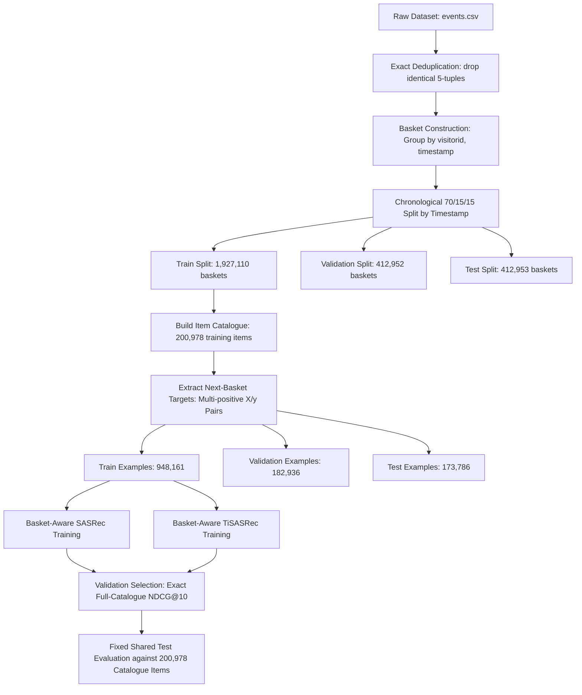

# TemporalRec: Time-Aware Sequential Recommendation Study

TemporalRec is a research study investigating whether explicit relative time intervals and same-timestamp basket modeling improve next-item ranking over pure sequence-order models in e-commerce session logs. The study evaluates a global popularity baseline, a basket-aware adaptation of SASRec, and a basket-aware adaptation of TiSASRec on the Retailrocket benchmark dataset.

---

## 1. Key Findings & Model Comparisons

On a fixed, chronological test split of 173,786 held-out prediction examples evaluated against the full 200,978-item training catalogue:

* **Basket-aware TiSASRec outperforms SASRec and Popularity across all top-$K$ metrics.** Modeling explicit relative time intervals between user interaction baskets provides a modest, consistent performance lift over pure positional sequence modeling.
* **Relative vs. Absolute Improvements (TiSASRec vs. SASRec at $K=10$):**
  * **NDCG@10:** Absolute gain of $+0.0086$ ($0.3898$ vs. $0.3811$), representing a **$+2.27\%$ relative improvement**.
  * **Hit Rate@10 (Event Hit Rate):** Absolute gain of $+0.0102$ ($0.4584$ vs. $0.4482$), representing a **$+2.27\%$ relative improvement**.
  * **Multi-Positive Recall@10:** Absolute gain of $+0.0102$ ($0.4581$ vs. $0.4479$), representing a **$+2.27\%$ relative improvement**.
* **Global Popularity fails on sequential next-item ranking**, achieving an NDCG@10 of only $0.0021$ ($0.4482$ for SASRec vs. $0.0046$ for Popularity on Hit Rate@10).

### Full-Catalogue Test Metric Comparison Table

All evaluation metrics are calculated by scoring every training-known item ($200,978$ total items) for all $173,786$ test examples on the fixed shared test split.

| Model | Checkpoint Selection | $K$ | Event Hit Rate (Hit@K) | Multi-Positive Recall@K | NDCG@K | Scoring Time (sec) |
|---|---|---|---|---|---|---|
| **Popularity** | Baseline (Global Top-K) | 1 | 0.0002 | 0.0002 | 0.0002 | 16.40 |
| **SASRec** | Epoch 15 (Val NDCG@10) | 1 | 0.3163 | 0.3160 | 0.3163 | — |
| **TiSASRec** | Epoch 15 (Val NDCG@10) | 1 | **0.3241** | **0.3238** | **0.3241** | 26.39 |
| **Popularity** | Baseline (Global Top-K) | 10 | 0.0046 | 0.0045 | 0.0021 | 16.40 |
| **SASRec** | Epoch 15 (Val NDCG@10) | 10 | 0.4482 | 0.4479 | 0.3811 | — |
| **TiSASRec** | Epoch 15 (Val NDCG@10) | 10 | **0.4584** | **0.4581** | **0.3898** | 26.39 |
| **Popularity** | Baseline (Global Top-K) | 20 | 0.0084 | 0.0083 | 0.0030 | 16.40 |
| **SASRec** | Epoch 15 (Val NDCG@10) | 20 | 0.4773 | 0.4770 | 0.3885 | — |
| **TiSASRec** | Epoch 15 (Val NDCG@10) | 20 | **0.4897** | **0.4894** | **0.3977** | 26.39 |
| **Popularity** | Baseline (Global Top-K) | 50 | 0.0192 | 0.0191 | 0.0052 | 16.40 |
| **SASRec** | Epoch 15 (Val NDCG@10) | 50 | 0.5149 | 0.5146 | 0.3960 | — |
| **TiSASRec** | Epoch 15 (Val NDCG@10) | 50 | **0.5284** | **0.5281** | **0.4054** | 26.39 |

*Source files:*
* Saved metrics summary: [`models/tisasrec_basket_v1/full_catalogue_comparison.csv`](models/tisasrec_basket_v1/full_catalogue_comparison.csv)
* TiSASRec per-example evaluation audit: [`models/tisasrec_basket_v1/tisasrec_full_catalogue_test_per_example.csv`](models/tisasrec_basket_v1/tisasrec_full_catalogue_test_per_example.csv)
* Popularity per-example evaluation audit: [`models/tisasrec_basket_v1/popularity_full_catalogue_test_per_example.csv`](models/tisasrec_basket_v1/popularity_full_catalogue_test_per_example.csv)
* Experiment decision log: [`DECISION_LOG.md`](DECISION_LOG.md) and run log: [`EXPERIMENT_LOG.md`](EXPERIMENT_LOG.md)

---

## 2. Problem Statement: Time Intervals & Same-Timestamp Baskets

Standard sequential recommendation models (such as vanilla SASRec) treat user behavior as an ordered sequence of discrete tokens $x_1, x_2, \dots, x_n$. This approach introduces two critical failures when applied to real-world e-commerce event logs:

1. **Fictitious Sequential Ordering in Timestamp Ties:** Raw interaction logs frequently record multiple events for a user at the exact same millisecond (e.g., viewing multiple items on a single page, or purchasing a multi-item cart). Arbitrarily sorting these events by file row order invents a false causal order between simultaneous interactions.
2. **Ignoring Inter-Basket Time Gaps:** In session logs, time gaps between consecutive interaction blocks range from seconds (within an active browsing session) to days or weeks. Pure positional order treats a 5-second gap between item views identically to a 3-week gap, discarding valuable recency and pacing signals.

### How TemporalRec Resolves These Issues

* **Same-Timestamp Basket Grouping:** Interactions sharing the same `(visitorid, timestamp)` are grouped into an unordered time block (basket). Items within a basket are represented via mean-pooled item embeddings. No artificial sequence order is imposed inside a basket.
* **Log-Bucketed Relative Time Intervals:** Relative time elapsed between baskets $i$ and $j$ ($\Delta t = t_i - t_j$) is computed in seconds and mapped to log-scale buckets:
  $$\text{bucket} = \min\left(31, \lfloor \log_2(\Delta t_{\text{seconds}} + 1) \rfloor\right)$$
  Learned relative-time embeddings for these 32 time buckets are added to both key and value projections inside TiSASRec's self-attention mechanism.

---

## 3. Data Pipeline & Architecture



---

## 4. Dataset Source, Statistics & Preprocessing

### Dataset Source
The project uses the **Retailrocket eCommerce Dataset**, consisting of visitor interaction logs (`view`, `addtocart`, `transaction`) spanning 138 days.

### Acquisition
The dataset is excluded from Git tracking. To acquire and place the file:
1. Download `events.csv` from the Retailrocket dataset source (e.g., Kaggle or official release).
2. Place `events.csv` at `dataset/events.csv` relative to the repository root.

### Dataset Pipeline Statistics
* **Raw Interactions:** $2,756,101$ events across $1,407,580$ visitors and $235,061$ unique items.
* **Exact Deduplication:** $460$ exact duplicate 5-tuple rows removed ($2,755,641$ cleaned events remain).
* **Prepared Baskets:** $2,753,015$ distinct `(visitorid, timestamp)` blocks constructed.
  * $2,750,872$ single-event blocks.
  * $1,633$ confirmed multi-item transaction baskets.
  * $499$ multi-item non-transaction blocks.
  * $11$ same-item tie blocks.
* **Chronological Split Boundaries (70% Train / 15% Validation / 15% Test):**
  * **Train:** May 3, 2015 – Aug 2, 2015 ($1,927,110$ baskets, $1,929,038$ events, $200,978$ unique items).
  * **Validation:** Aug 2, 2015 – Aug 25, 2015 ($412,952$ baskets, $413,314$ events, $97,619$ items).
  * **Test:** Aug 25, 2015 – Sep 18, 2015 ($412,953$ baskets, $413,289$ events, $97,570$ items).
* **Training Item Catalogue:** Derived strictly from training split items ($200,978$ items mapped to indices $1 \dots 200,978$, reserve index $0$ for padding).
  * Validation item coverage: $93.25\%$ of validation events contain training-known items ($385,393 / 413,311$ rows).
  * Test item coverage: $89.18\%$ of test events contain training-known items ($368,550 / 413,288$ rows). Unseen items during test time are filtered prior to scoring.

---

## 5. Model Implementations & Adaptations

### SASRec Adaptation
* **Original Published Method (Kang & McAuley, 2018):** Unidirectional self-attention network over single item token sequences.
* **Our Adaptation:** Custom PyTorch implementation supporting unordered baskets via mean-pooling basket encoders, multi-positive sampled cross-entropy loss, and full-catalogue evaluation scoring.

### TiSASRec Adaptation
* **Original Published Method (Li et al., 2020):** Time-interval aware self-attention adding learned relative time interval embeddings to attention matrix calculations for single item sequences.
* **Our Adaptation:** Implemented in [`src/temporalrec/models/tisasrec.py`](src/temporalrec/models/tisasrec.py). Combines mean-pooled basket representations with causal relative-time self-attention over history baskets (up to $20$ baskets). Uses 32 log-2 elapsed time buckets computed from inter-basket timestamps in milliseconds.

### Model Architecture Parameters
* **Embedding Dimension:** $64$
* **Transformer Layers:** $2$
* **Attention Heads:** $2$
* **Feed-Forward Dimension:** $128$
* **Max History Length:** $20$ baskets
* **Relative Time Buckets:** $32$ (TiSASRec)
* **Sampled Negative Items per Positive:** $256$
* **Optimizer & Schedule:** AdamW ($\text{lr}=10^{-3}$, $\text{weight\_decay}=10^{-4}$), gradient clipping norm $1.0$, bfloat16 mixed precision training.

---

## 6. Evaluation Protocol

To prevent evaluation leakage and ensure rigorous ranking comparison:

1. **Strict Chronological Splitting:** Split by overall timestamp cutoffs ($70\%$ train, $15\%$ validation, $15\%$ test). All interactions occurring at or before a cutoff timestamp remain strictly in that split.
2. **Training-Only Catalogue Filtering:** The model item catalogue ($200,978$ items) is fitted exclusively on training interactions. Unseen items in validation/test targets are excluded during evaluation.
3. **Full-Catalogue Ranking Candidates:** During evaluation, every prediction example scores all $200,978$ items in the training catalogue. No sampled candidates ($1:100$) are used for final metric reporting.
4. **Multi-Positive Targets & Same-Basket Handling:** If a target basket contains multiple items, all items in that basket serve as valid positive targets.
5. **Repeat Item Handling:** Repeat interactions across different timestamps are preserved as separate historical baskets. Items inside the same timestamp block are deduplicated to distinct memberships.
6. **Checkpoint Selection:** Checkpoints are selected based on maximum full-catalogue NDCG@10 on the **validation split**. The test split is evaluated exactly once on the selected checkpoint.
7. **Metric Definitions:**
   * **Event Hit Rate (Hit@K):** Proportion of prediction examples where at least one target item appears in top-$K$ recommendations.
   * **Multi-Positive Recall@K:** Average proportion of target items retrieved in top-$K$:
     $$\text{Recall@K} = \frac{1}{|N|} \sum_{i=1}^{|N|} \frac{|\text{Top-K}_i \cap \text{Targets}_i|}{|\text{Targets}_i|}$$
   * **NDCG@K (Normalized Discounted Cumulative Gain):** Position-discounted ranking gain normalized by ideal DCG (IDCG) for multi-positive target sets.

---

## 7. Setup & Reproduction Instructions

### Prerequisites & Environment
* **Python Version:** $\ge 3.11$ (tested with Python 3.12 / 3.13)
* **Package Manager:** `uv` or standard `pip`
* **Hardware Requirements:** CUDA-capable GPU (experiments executed on NVIDIA RTX 4070 Laptop GPU).

### Installation & Inspection Check

1. **Clone the repository and install dependencies:**
   ```bash
   git clone https://github.com/your-username/TemporalRec.git
   cd TemporalRec
   pip install -e .
   ```

2. **Run existing unit tests:**
   ```bash
   PYTHONPATH=src python -m unittest discover -s tests -v
   ```

3. **Inspect the raw Retailrocket dataset (after acquiring `dataset/events.csv`):**
   ```bash
   PYTHONPATH=src python scripts/inspect_retailrocket.py --events dataset/events.csv --output reports/retailrocket_inspection.json
   ```

### Execution Workflow

To execute or reproduce data preparation, training, and evaluation:

1. **Data Cleaning & Audits:** Run notebooks `notebooks/01_data_quality_cleaning.ipynb` through `notebooks/06_timestamp_basket_tradeoff.ipynb`.
2. **Basket Preparation & Chronological Splitting:** Run `notebooks/07_build_basket_dataset.ipynb` (or execute script workflow) to construct `data/interim/chronological_split_70_15_15/training_reframe/` data artifacts.
3. **Model Training:**
   * Train TiSASRec via notebook [`11_tisasrec_training.ipynb`](11_tisasrec_training.ipynb) or python entrypoint:
     ```bash
     PYTHONPATH=src python scripts/train_tisasrec.py
     ```
   * Models train for up to 15 epochs with early stopping (patience 3) based on validation NDCG@10. Checkpoints save to `models/tisasrec_basket_v1/best_model_by_validation_ndcg10.pt`.
4. **Full-Catalogue Evaluation:**
   * Run evaluation notebook [`12_tisasrec_full_catalogue_evaluation.ipynb`](12_tisasrec_full_catalogue_evaluation.ipynb) or script:
     ```bash
     PYTHONPATH=src python scripts/evaluate_tisasrec.py
     ```

---

## 8. Repository Structure

```
TemporalRec/
├── configs/                  # Dataset and run configuration schemas
├── dataset/                  # Local dataset folder (events.csv excluded from Git)
├── docs/
│   └── DATASET_STRATEGY.md   # Data contract, splitting rules, and benchmark scope
├── models/
│   ├── sasrec_basket_v1/     # SASRec training history and test evaluation artifacts
│   └── tisasrec_basket_v1/   # TiSASRec checkpoint, metrics, and test comparison CSVs
├── notebooks/                # Numbered exploratory and preparation notebooks (01 to 07)
├── reports/                  # Generated audit CSVs, summary tables, and manifests
├── scripts/
│   ├── inspect_retailrocket.py  # Dataset sanity inspector
│   ├── train_tisasrec.py        # TiSASRec training script
│   └── evaluate_tisasrec.py     # Full-catalogue test evaluation script
├── src/
│   └── temporalrec/
│       ├── data/             # Basket dataset loaders and sequence builders
│       └── models/           # PyTorch TiSASRec & basket encoder implementations
├── tests/                    # Unit tests for data structures and model logic
├── 08_Data_Preparation_ready-Copy1.ipynb   # Saved execution copy of preparation
├── 11_tisasrec_training.ipynb              # TiSASRec model training execution copy
├── 12_tisasrec_full_catalogue_evaluation.ipynb # Test evaluation execution copy
├── DECISION_LOG.md           # Registered research and data decision entries
├── EXPERIMENT_LOG.md         # Full record of model training and evaluation runs
├── pyproject.toml            # Project dependencies and environment metadata
└── README.md                 # Project documentation
```

---

## 9. Limitations & Future Work

### Limitations & Reproducibility Gaps
* **Shared Fixed Test Set:** The test split metrics serve as a fixed shared comparison across SASRec, TiSASRec, and Popularity. Because initial SASRec test results were inspected during study setup, test outputs cannot be used for post-hoc hyperparameter tuning.
* **Hardware Sensitivity:** Model training scripts enforce CUDA execution with bfloat16 mixed precision. Execution on CPU or non-CUDA backends requires code adjustments.
* **Scope Scope & Cold-Start:** Evaluation filters out items unseen during training ($10.82\%$ of test interaction rows), measuring ranking quality strictly on training-known item sets.
* **Offline Ranking Metrics:** Metrics measure offline ranking accuracy on historical user interaction logs and do not imply online conversion or commercial business impact.

### Planned Future Work
* **Statistical Significance Testing:** Perform paired bootstrap resampling across the $173,786$ test prediction examples to establish confidence intervals for the $+2.27\%$ relative NDCG@10 gain.
* **Secondary H&M Benchmark Execution:** Apply the frozen basket-aware evaluation protocol to the day-level H&M transaction dataset to evaluate cross-dataset robustness.
* **Time Interval Hyperparameter Ablations:** Compare alternative log-bucketing functions, linear interval caps, and continuous time decay attention maps.

---

## 10. References & License

### Key References
1. **SASRec:** Wang-Cheng Kang and Julian McAuley. 2018. *Self-Attentive Sequential Recommendation*. In ICDM 2018.
2. **TiSASRec:** Jiacheng Li, Yujie Wang, and Julian McAuley. 2020. *Time Interval Aware Self-Attention for Sequential Recommendation*. In WSDM 2020.
3. **Retailrocket Dataset:** Retailrocket eCommerce Dataset, published 2016.

### License
This repository is released under the [Apache License 2.0](LICENSE).
